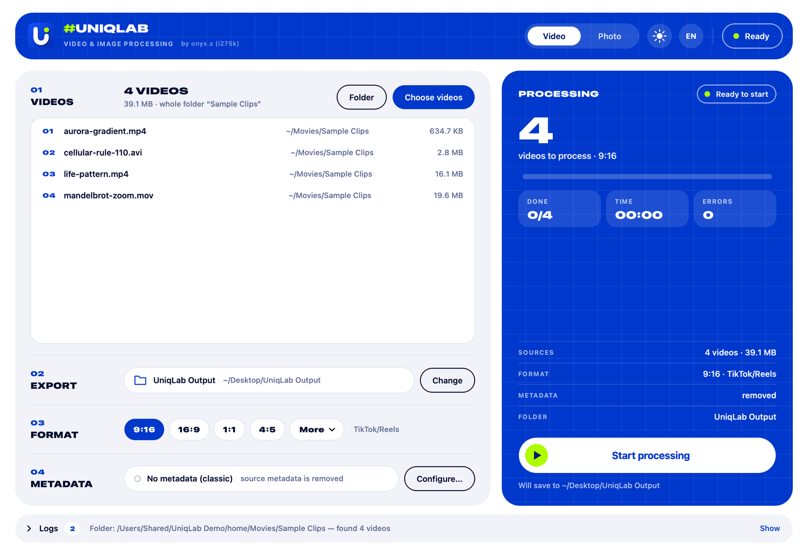
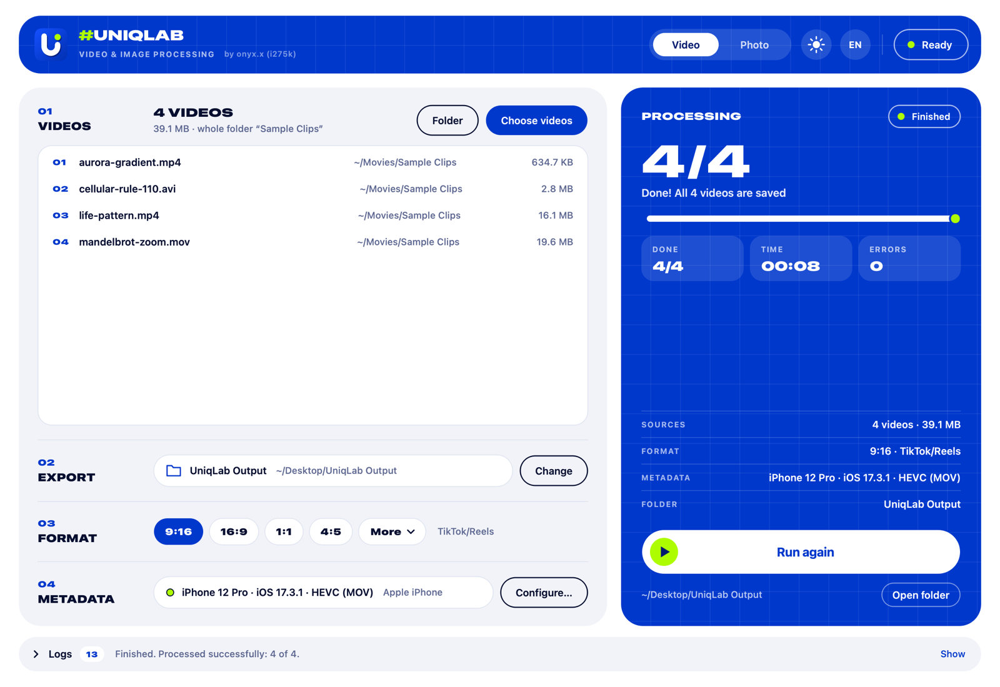
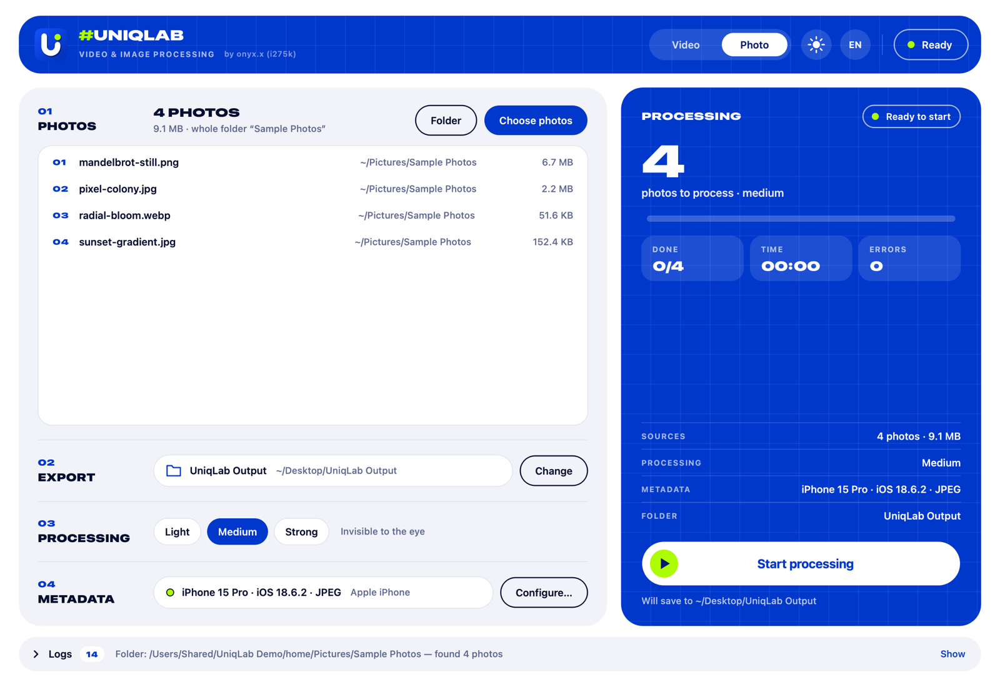
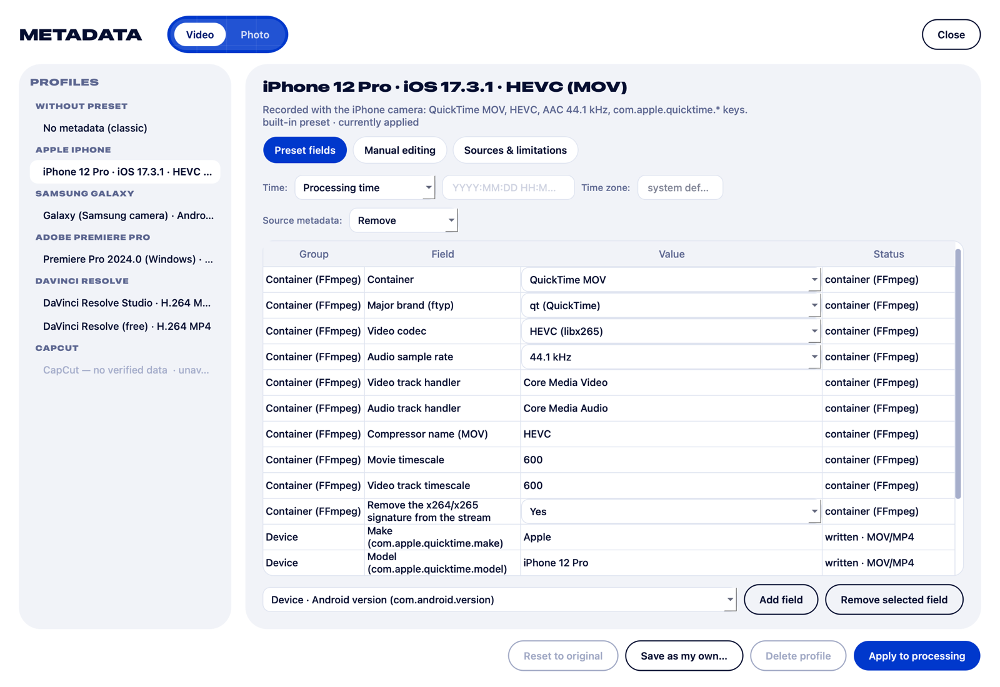
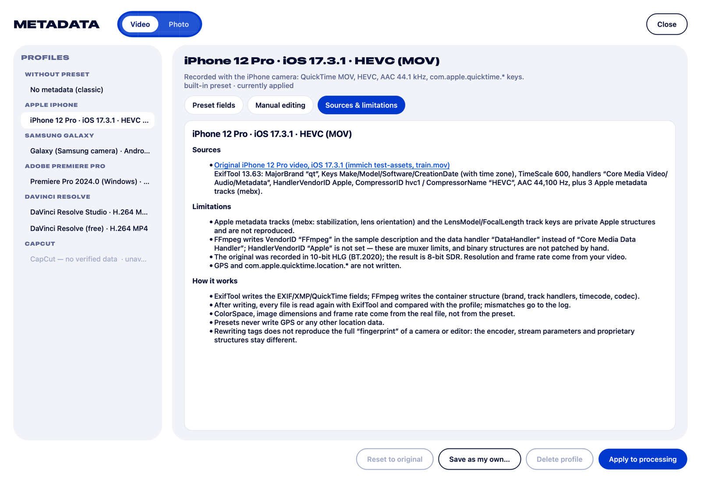
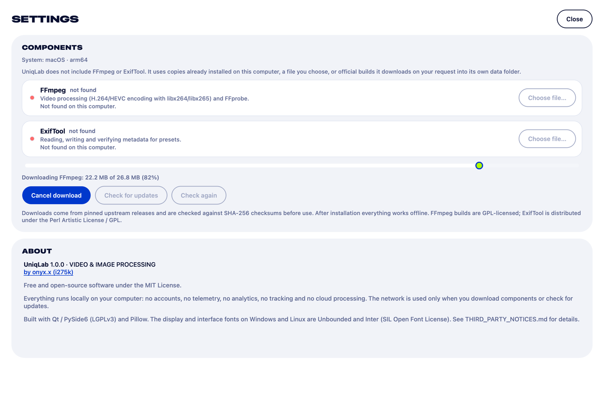
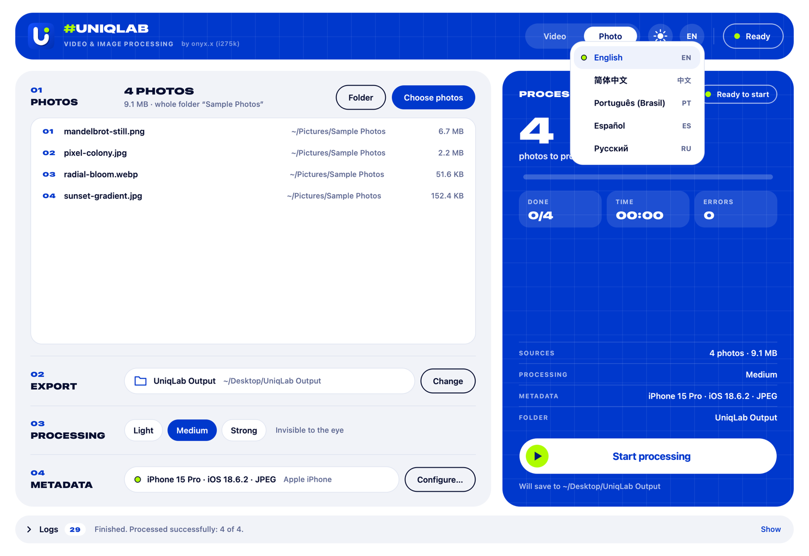
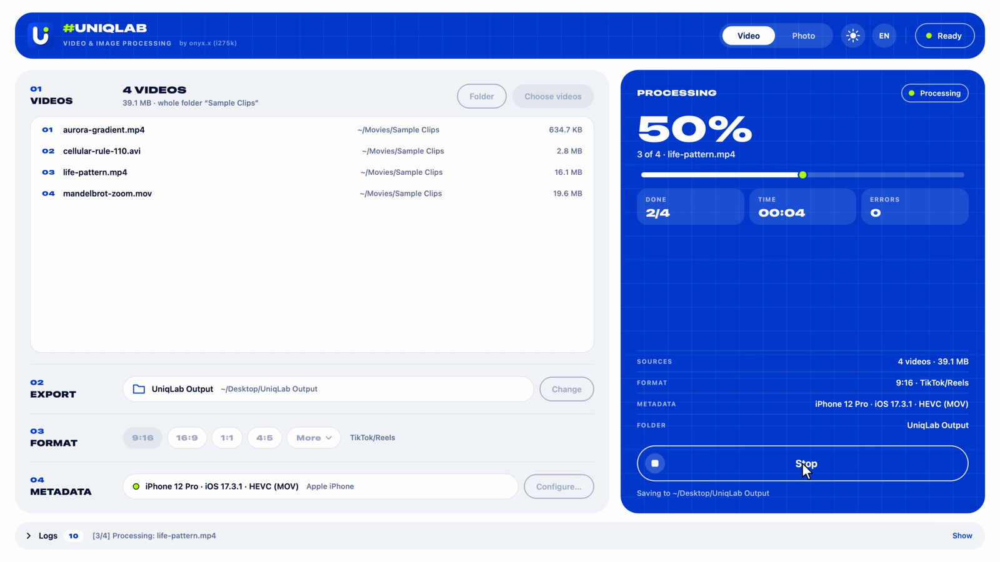

<div align="center">


# UniqLab

**Make new, distinct copies of your videos and photos — locally, privately, in batches.**

UniqLab is a free and open-source video and image processing tool for macOS, Windows and Linux.
It batch-processes videos and photos into new files, removes metadata, and includes a metadata
editor with documented device and editor presets. It works as a simple graphical interface for
FFmpeg and ExifTool — no command line needed — and processes everything offline on your computer.

<a href="https://github.com/i275k/UniqLab/releases/latest/download/UniqLab-macos-arm64.dmg"></a>
<a href="https://github.com/i275k/UniqLab/releases/latest/download/UniqLab-windows-x64.exe"></a>
<a href="https://github.com/i275k/UniqLab/releases/latest/download/UniqLab-linux-x64.AppImage"></a>

<sub>[All releases](https://github.com/i275k/UniqLab/releases) · [Installation guide](#how-to-install) · [SHA-256 checksums](https://github.com/i275k/UniqLab/releases/latest/download/SHA256SUMS.txt)</sub>

[Features](#features) · [Use cases](#use-cases) · [FAQ](#faq)

<br>

<picture>
  <source media="(prefers-color-scheme: dark)" srcset="docs/assets/screenshots/02-video-mode-dark.png">
  
</picture>

</div>

## What is UniqLab?

You add videos or photos — individual files or a whole folder — and UniqLab saves a new version
of each one in the folder you choose. Every output is a separate, freshly encoded file with small
changes to framing, tone and noise, made to keep the original look. Your originals are never
modified.

By default the metadata of the source file is removed. Instead, you can apply a **metadata
preset** — documented tags of a device or editing app, such as an iPhone or Adobe Premiere Pro —
or build your own. After writing, UniqLab reads every field back and reports what was verified
and what was skipped.

## Download

| System | Direct download (latest version) |
|---|---|
| **macOS 13 or newer** · Apple silicon (M-series) | [UniqLab-macos-arm64.dmg](https://github.com/i275k/UniqLab/releases/latest/download/UniqLab-macos-arm64.dmg) |
| **Windows 10 / 11** · x64 · no admin rights needed | [UniqLab-windows-x64.exe](https://github.com/i275k/UniqLab/releases/latest/download/UniqLab-windows-x64.exe) |
| **Linux** · x86_64 · glibc 2.35+ | [UniqLab-linux-x64.AppImage](https://github.com/i275k/UniqLab/releases/latest/download/UniqLab-linux-x64.AppImage) |

Click a file name and the download starts right away. Older versions and release notes are on the
[Releases page](https://github.com/i275k/UniqLab/releases). To check that your download is intact,
compare it with [SHA256SUMS.txt](https://github.com/i275k/UniqLab/releases/latest/download/SHA256SUMS.txt) — see [docs/INSTALL.md](docs/INSTALL.md).

> [!NOTE]
> UniqLab is not signed with a paid developer certificate. The first time you open it, macOS or
> Windows will show a warning — this is expected. The [installation steps](#how-to-install) below show
> how to open it.

Not available in version 1.0: Intel Macs, Windows on ARM and Linux on ARM.

## Features

### Batch video processing
- Process any number of **MP4, MOV and AVI** files at once — pick files or a whole folder.
- **Subtle changes in every output:** a short random trim at both ends, light noise, a small
  brightness or contrast shift and a new random file name.
- **Aspect ratios for every platform:** 9:16 (TikTok, Reels), 16:9 (YouTube), 1:1 and 4:5
  (Instagram), 2:3 (Pinterest), 4:3, 3:4, 21:9, 3:2, 5:4 — or a random crop.
- **CPU encoding** with FFmpeg: H.264 (MP4) by default, HEVC (MOV/MP4) with some presets.
- Clear progress, a per-file log, a Stop button and a summary when the batch is done.

### Batch photo processing
- **JPEG, PNG and WebP** — the output keeps the original format and dimensions.
- **Three strengths** (Light, Medium, Strong) of tiny framing, tone and noise changes.
- Keeps transparency, the color profile and the photo orientation. Works without FFmpeg.

### Metadata remover and editor
- **Removes source metadata by default** — camera, dates, software and location tags of the
  original file are not carried over.
- **Metadata presets** for video (iPhone 12 Pro, Samsung Galaxy, Adobe Premiere Pro 2024,
  DaVinci Resolve) and photos (iPhone 15 Pro, iPhone 16 Pro, Galaxy S25 Ultra, Galaxy S24).
- **Verified after writing:** every field is read back and compared, for example
  `metadata verified: 14/14`.
- **Transparent:** each preset lists its sources and what it does not reproduce.
- **Editable:** change values, import tags from any of your own files and save your own presets.
- **Presets never add GPS or location data.**

### Private and offline
- **No account, no telemetry, no analytics, no cloud.** Your files never leave your computer.
- **Works offline** once FFmpeg and ExifTool are installed.
- **One-click setup** of FFmpeg and ExifTool: pinned builds, verified with SHA-256 and installed
  without administrator rights.
- **Five interface languages** and a light, dark or automatic theme.

## Use cases

- **Posting the same clip on several platforms.** Export a 9:16 version for TikTok and Reels and
  a 16:9 version for YouTube from the same source, each as a separate, freshly encoded file.
- **Removing metadata before sharing.** Strip camera, date, software and location information
  from videos and photos before you send them to a client or publish them.
- **Consistent metadata across a batch.** Apply one documented preset — or your own — to many
  files and check in the log exactly which fields were written.
- **Inspecting a file's metadata.** Open any photo or video on the *Manual editing* tab to see its
  tags and copy the ones you need into your own preset.
- **Working without internet.** Process whole folders on a laptop while traveling or on an
  offline machine.

## Screenshots

<table>
  <tr>
    <td width="50%"></td>
    <td width="50%"></td>
  </tr>
  <tr>
    <td align="center"><sub>Batch video processing</sub></td>
    <td align="center"><sub>Photo mode</sub></td>
  </tr>
  <tr>
    <td></td>
    <td></td>
  </tr>
  <tr>
    <td align="center"><sub>Metadata editor</sub></td>
    <td align="center"><sub>Sources and limitations of every preset</sub></td>
  </tr>
  <tr>
    <td></td>
    <td></td>
  </tr>
  <tr>
    <td align="center"><sub>One-click FFmpeg and ExifTool setup</sub></td>
    <td align="center"><sub>Five interface languages</sub></td>
  </tr>
</table>

### Demo video

**[Watch the 45-second demo](docs/assets/uniqlab-demo.mp4)**

<a href="docs/assets/uniqlab-demo.mp4"></a>

A 45-second recording of the real app: processing a folder of videos with a metadata preset,
photo mode, the dark theme, switching languages and the component manager.

## How to install

### macOS
1. Open the `.dmg` file and drag **UniqLab** into **Applications**.
2. Open UniqLab. macOS says it cannot verify the developer — click **Done**.
3. Go to **System Settings → Privacy & Security**, scroll down and click **Open Anyway** next to
   the message about UniqLab. Confirm with your password or Touch ID.

### Windows
1. Run the `.exe` installer.
2. If you see *“Windows protected your PC”*, click **More info → Run anyway**.
3. UniqLab installs for your user account only and needs no administrator rights.
   Uninstall it any time from **Settings → Apps**.

### Linux
```bash
chmod +x UniqLab-linux-x64.AppImage
./UniqLab-linux-x64.AppImage
```
If the AppImage does not start, install FUSE 2 (`sudo apt install libfuse2` on Ubuntu 22.04,
`libfuse2t64` on 24.04 and newer) or run it with `--appimage-extract-and-run`.
Metadata presets need Perl (`sudo apt install perl` if it is missing).

### First launch
If FFmpeg (for video) or ExifTool (for metadata) is missing, UniqLab offers to download it —
click **Download & Install All**. Nothing is downloaded without your consent, and photo mode
works right away.

More details, including checksum verification: [docs/INSTALL.md](docs/INSTALL.md).

## How to use UniqLab

1. Choose **Video** or **Photo** at the top of the window.
2. Click **Choose videos** / **Choose photos**, or **Folder** to add a whole folder.
3. Choose where to save the results.
4. For video, pick an aspect ratio; for photos, pick a strength.
5. Optionally click **Configure…** to choose a metadata preset.
6. Click **Start processing**, then **Open folder** to see the new files.

## Languages

| Language | Code |
|---|---|
| English | en |
| 简体中文 (Simplified Chinese) | zh-CN |
| Português (Brasil) | pt-BR |
| Español | es |
| Русский | ru |

UniqLab picks your system language on first launch. Switch at any time with the language button
in the header — no restart needed.

## FAQ

<details>
<summary><b>Is UniqLab free?</b></summary>

Yes. UniqLab is free and open source under the MIT License. There is no account, subscription or
paid version.
</details>

<details>
<summary><b>Does UniqLab upload my files or collect any data?</b></summary>

No. All processing happens on your computer, and UniqLab has no telemetry, analytics, crash
reporting or cloud features. It goes online only when you click **Download & Install All** or
**Check for updates**, and then connects only to the sources of those tools: ffmpeg.martin-riedl.de
(FFmpeg for macOS), the FFmpeg-Builds project on GitHub (FFmpeg for Windows and Linux), and
exiftool.org and SourceForge (ExifTool).
</details>

<details>
<summary><b>How do I remove metadata from a video or photo?</b></summary>

Add your files and start processing — the default **No metadata** setting removes the source
file's metadata, such as camera model, dates, editing software and location. Photos keep only
their orientation and color profile so they display correctly. A new video still contains the
basic technical information that every encoded file has (codec, resolution, duration and, without
a preset, FFmpeg's encoder name). Choose **Keep and extend** in the metadata settings if you want
to keep the source metadata instead.
</details>

<details>
<summary><b>What does UniqLab change in a video?</b></summary>

Each output gets a random 0.05–0.15 s trim at the start and end, light temporal noise, a random
1–2 % brightness or contrast shift and a crop to the aspect ratio you chose (or a random 2–10 %
crop). It is re-encoded and gets a new random file name. Existing files are never overwritten.
</details>

<details>
<summary><b>What does UniqLab change in a photo?</b></summary>

A very slight crop that is scaled back to the exact original size, tiny brightness, contrast and
saturation shifts, and fine noise. The size of each change depends on the strength you choose.
Dimensions, format, transparency, color profile and orientation stay the same.
</details>

<details>
<summary><b>Can I edit metadata and create my own presets?</b></summary>

Yes. On the metadata page you can change the values of any preset, add or remove supported fields,
import selected tags from your own photos and videos on the *Manual editing* tab, and save the
result as your own preset. You can set the date and time to the processing time, the source
file's time or a value of your choice.
</details>

<details>
<summary><b>Does a metadata preset make my file identical to one from a real iPhone or editor?</b></summary>

No. Presets reproduce documented, publicly verifiable tags, not every proprietary detail of a real
camera or editor file. Each preset lists its sources and its limitations on the
*Sources & limitations* tab. Presets never add GPS or location data; if you choose
**Keep and extend**, whatever the source file already contains is carried over.

Metadata can be edited by anyone, so it is not proof of where a file came from or of its
authenticity — and UniqLab's presets are not meant to be used that way.
</details>

<details>
<summary><b>Do I need to install FFmpeg or ExifTool myself?</b></summary>

No. UniqLab detects copies already installed on your system; if there are none, **Download &
Install All** downloads pinned builds, checks their SHA-256 checksums and stores them in UniqLab's
own folder without administrator rights. You can also choose an existing copy in
**Settings → Components**. They are not included in the installer because they are separate
projects with their own licenses.
</details>

<details>
<summary><b>Why does macOS or Windows warn me when I open UniqLab?</b></summary>

UniqLab is not signed with a paid Apple or Microsoft certificate, so the system cannot confirm the
developer. Follow the [installation steps](#how-to-install) to open it.
</details>

<details>
<summary><b>Which video and image formats does UniqLab support?</b></summary>

Video: MP4, MOV and AVI in; MP4 or MOV out. Photo: JPEG, PNG and WebP (the output keeps the input
format). HEIC, RAW and animated images are not supported.
</details>

<details>
<summary><b>Does UniqLab work offline?</b></summary>

Yes. Once FFmpeg and ExifTool are installed, all processing works without an internet connection.
</details>

<details>
<summary><b>Does UniqLab use GPU acceleration?</b></summary>

Not in version 1.0. Encoding runs on the CPU.
</details>

## System requirements

| | macOS | Windows | Linux |
|---|---|---|---|
| Version | macOS 13 Ventura or newer | Windows 10 or 11 | glibc 2.35 or newer (e.g. Ubuntu 22.04+) |
| Processor | Apple silicon (arm64) | x64 | x86_64 |
| Also needed | — | — | Perl (for metadata), FUSE 2 or `--appimage-extract-and-run` |

**Testing status.** Each package is built and smoke-tested automatically on GitHub Actions: the
packaged app is launched, installs FFmpeg and ExifTool, and processes sample videos and photos
with metadata presets while its network access is blocked. The app has been used hands-on on
macOS; hands-on testing on Windows and Linux desktops has not been done yet. Please
[open an issue](https://github.com/i275k/UniqLab/issues) if something does not work.

<details>
<summary><b>Where does UniqLab keep its settings? How do I reset or uninstall it?</b></summary>

| System | Folder |
|---|---|
| macOS | `~/Library/Application Support/UniqLab` |
| Windows | `%LOCALAPPDATA%\UniqLab` |
| Linux | `~/.local/share/UniqLab` (or `$XDG_DATA_HOME/UniqLab`) |

The folder holds `settings.json`, your own presets (`metadata_profiles.json`) and the components
UniqLab downloaded (`tools/`). Delete it to reset everything. To use another folder, set the
`UNIQLAB_DATA_DIR` environment variable.
</details>

## Build from source

<details>
<summary>Run UniqLab from source with Python 3.12</summary>

```bash
git clone https://github.com/i275k/UniqLab.git
cd UniqLab
python3.12 -m venv .venv
source .venv/bin/activate        # Windows: .venv\Scripts\activate
pip install -r requirements.txt
python -m uniqlab
```

Manage components from the command line:

```bash
python -m uniqlab.dependencies status
python -m uniqlab.dependencies install
```

Built with Python 3.12, PySide6 (Qt 6) and Pillow. See [docs/BUILDING.md](docs/BUILDING.md) for
tests, packaging and the release workflow.
</details>

## License

UniqLab is released under the [MIT License](LICENSE).

The app packages include third-party software — Qt and PySide6 (LGPL-3.0), Pillow, certifi and the
Inter and Unbounded fonts (SIL OFL 1.1). FFmpeg and ExifTool are downloaded separately on request
and keep their own licenses. Details and full license texts:
[THIRD_PARTY_NOTICES.md](THIRD_PARTY_NOTICES.md) and [licenses/](licenses/).

Use UniqLab only with media you have the right to edit. Product names in metadata presets are
trademarks of their owners; UniqLab is not affiliated with or endorsed by them.

---

<div align="center">
<sub>Made by <b>onyx.x</b> · <a href="https://github.com/i275k">GitHub</a> · <a href="https://x.com/i275k">X</a></sub>
</div>
